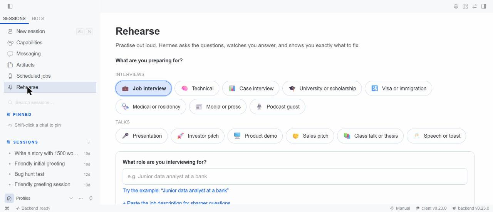
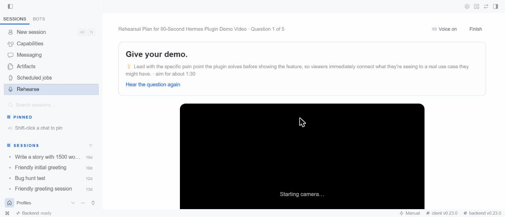

# Rehearse

**Practise out loud. Hermes asks the questions, watches you answer, and shows you exactly what to fix.**



Rehearse turns Hermes into a patient coach for **any interview or talk**. Pick what you are preparing
for, type the role or topic, and press **Start**:

| Interviews | Talks |
|---|---|
| 💼 Job · 🧠 Technical · 📊 Case | 🎤 Presentation · 🚀 Investor pitch · 🖥️ Product demo |
| 🎓 University or scholarship · 🛂 Visa or immigration | 🤝 Sales pitch · 📚 Class talk or thesis defence |
| 🩺 Medical or residency · 📰 Media or press · 🎙️ Podcast guest | 🥂 Speech or toast |

Each one has its own questioner (a consular officer, a case interviewer, a journalist, an investor, a thesis
committee) with its own questions, ideal answer lengths and idea of what a good answer is. Questions and
feedback come in the language you write in, and you can pick the interviewer's voice from any voice installed
on your computer (a British, American, French or Nigerian-English interviewer, offline and free). Hermes asks
out loud, you answer on camera (or upload a recording), and a few seconds later you get a scored replay:

- **Filler words** ("um", "uh", "like,", "you know,"), each marked on the timeline at the moment you said it
- **Pace** in words per minute, with the stretches where you rushed or dragged
- **Long pauses**, stumbles and repeated words
- **Answer length** against what an interviewer expects for that question
- **Eye contact**: how much of the time you faced the camera, and when you looked away
- **Content feedback**: what worked, what to fix first, an outline of a stronger answer built only from what
  you said (gaps are left in `[brackets]` for you to fill, never invented), and the follow-up question you
  are most likely to get next



Press **Try this one again** and Rehearse tells you how many points you gained. Your history shows your
scores over time.

## Who it is for

Job seekers and career changers, students facing a presentation, defence or admission interview, people
preparing a visa interview, doctors applying for residency, founders before a pitch or a demo day,
salespeople, anyone about to be interviewed by a journalist or a podcast host, anyone with a wedding speech,
and people practising in a second language. Feedback that used to need a
coach or a patient friend, available at 11pm the night before, as many times as you want.

## Use it

**Hermes Desktop** (the full experience): open **Rehearse** in the sidebar.

**Any chat, including Telegram and Discord:**

```
/rehearse job junior data analyst at a bank
/rehearse visa student visa for a master's in Canada
/rehearse demo my Hermes plugin, 90 seconds
/rehearse history
```

Answer by text or voice note. A voice note arrives as text in chat, so there you get content feedback and
filler-word counts; pace, pauses and eye contact need the Desktop page. You can also just ask Hermes:
*"Give me a mock interview for a nursing job"*.

## Install

```
hermes plugins install rehearse
```

Hermes asks once to install the speech and face-detection packages. Requires Hermes **0.23.0** or newer.

Then, in Hermes Desktop, open **Capabilities → Plugins**, find **Rehearse** and switch it **On**: Hermes
keeps every plugin's Desktop page off until you choose to turn it on. **Rehearse** appears in the sidebar.

| Platform | Status |
|---|---|
| Windows (x64), Linux, macOS on Apple Silicon | Full analysis |
| macOS on Intel, Windows on ARM | Content feedback only: Hermes's local speech engine (faster-whisper) has no build for these, the same limit Hermes's own voice features have |

## Settings

Settings → Plugins → Rehearse (or `plugins.entries.rehearse.settings` in `config.yaml`):

| Setting | Default | |
|---|---|---|
| `whisper_model` | `base` | `tiny` is fastest, `small` is most accurate |
| `language` | auto | Spoken language code (`en`, `fr`, `es`, ...). Filler-word detection is tuned for English |
| `keep_recordings` | `true` | Turn off to delete each recording as soon as it is scored |

## What it does on your computer (disclosure)

- **Camera and microphone** are used only while you are on the practice screen, and stop when you leave it.
- **Speech-to-text and eye-contact analysis run locally** (faster-whisper and OpenCV). No audio or video
  leaves your computer.
- **The transcript of each answer is sent to your configured AI model** (through Hermes, with your existing
  sign-in) to write the questions and the content feedback. Nothing else is sent, and Rehearse has no
  network service or telemetry of its own.
- **One-time downloads, from their official sources:** the speech model (about 150 MB, from the
  faster-whisper project on Hugging Face) and OpenCV's YuNet face model (230 KB, from the
  `opencv/opencv_zoo` repository at a pinned commit, verified against its SHA-256 before use).
- **Stored data:** sessions, scores and recordings live in Hermes's plugin data folder for your profile
  (`plugin-data/rehearse`). Delete any session from the page, or delete the folder. Unused uploads are
  removed after a day.
- **No shell commands, no background processes** beyond the analysis of a take you just recorded.
- **Honest coaching:** for visa, immigration and admission interviews the coach helps you tell the truth
  clearly and never suggests misrepresenting your situation.

Eye contact is estimated from head direction (face landmarks), not true gaze tracking.

## How it works

```
Desktop page ──record──► dashboard/plugin_api.py  (stores the take)
     │
     └──/rehearse app <method>──► bridge.py ──► pipeline.py
                                               ├─ speech.py   faster-whisper, word timestamps
                                               ├─ face.py     OpenCV YuNet, head direction at 2 fps
                                               ├─ delivery.py fillers, pace, pauses, length, scores
                                               └─ coach.py    questions + feedback via ctx.llm
```

The page talks to the plugin through its own slash command over `command.dispatch`, so it works on the
current Hermes release. Slow work runs as polled background jobs, so the app never freezes.

## Development

```
pip install "faster-whisper==1.2.1" "av==18.1.0" "opencv-python-headless>=4.10,<6" pytest fastapi httpx python-multipart
pytest tests
hermes plugins validate .
```

MIT licensed.
